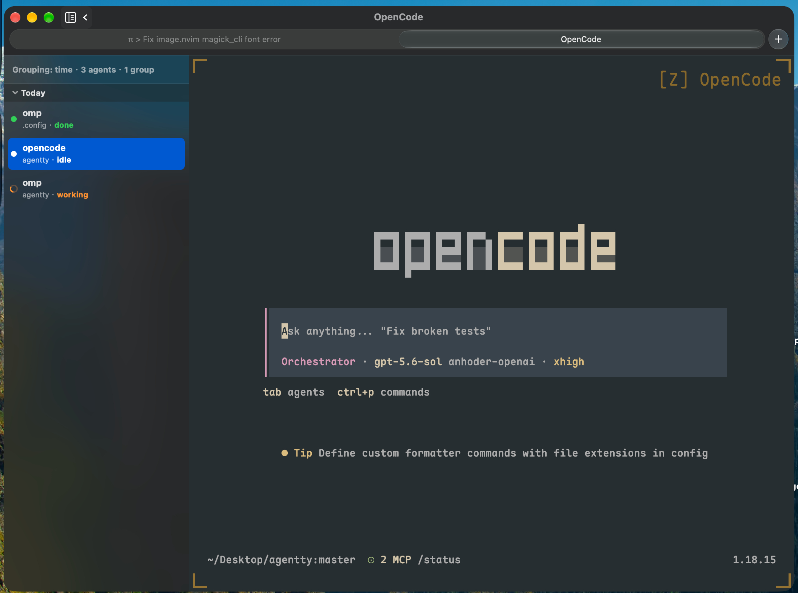

= agentty - Kitty-based macOS terminal with native tab bar and deep integration with AI Agent.

---

If you live in the terminal, *kitty* is made for **you**!

See https://sw.kovidgoyal.net/kitty/[the kitty website].

image:https://github.com/anhoder/agentty/actions/workflows/ci.yml/badge.svg["Unit tests", link="https://github.com/anhoder/agentty/actions/workflows/ci.yml"]

== GitHub Actions

* `CI`: Python and Go unit tests on Linux and macOS for pushes to `master` and pull requests targeting it. Older runs are cancelled when new commits arrive.
* `Build`: unsigned universal macOS DMGs for `v*` tags and daily nightly builds at 18:00 UTC (02:00 China Standard Time). Both workflows can also be started manually; manual builds must select `master` or a `v*` tag.
* Tag builds upload their DMG to the matching GitHub Release. Scheduled and manual branch builds update the `nightly` prerelease and its tag to the built commit. Download them from https://github.com/anhoder/agentty/releases[Releases].
* DMG builds use `make macos-app-deps` and `make macos-app`, including the packaged application's tests. Signing and notarization are disabled; no personal certificate or release token is required beyond the workflow's `GITHUB_TOKEN`.

== Upstream resources

https://sw.kovidgoyal.net/kitty/faq/[Frequently Asked Questions]

To ask other questions about kitty usage, use either the https://github.com/kovidgoyal/kitty/discussions/[discussions on GitHub] or the
https://www.reddit.com/r/KittyTerminal[Reddit community]

Packaging status in various repositories:

image:https://repology.org/badge/vertical-allrepos/kitty-terminal.svg?columns=3&header=kitty["Packaging status", link="https://repology.org/project/kitty-terminal/versions"]
